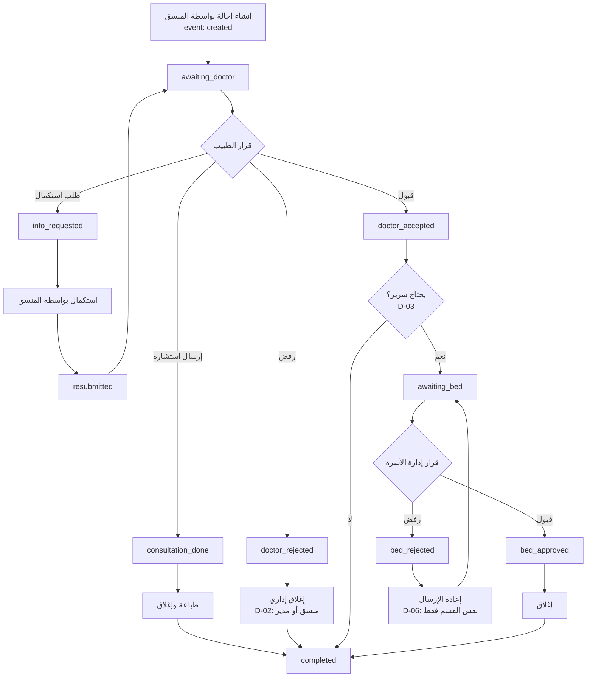

# وثيقة التصميم الهندسي والتقني — نظام وَصْل
## Technical Design & Developer Handover — v1.1

**الإصدار:** 1.1 (يُعدّل ويستكمل v1.0)
**التاريخ:** 2026-11-27
**المرجع:** v1.0 + docs/decisions.md + docs/policies.md
**الحالة:** جاهزة للتسليم للمبرمج بعد التوقيع على القرارات

---

## 0. سجل التغييرات عن v1.0

هذا الإصدار يُغلق **10 فجوات حرجة** ظهرت في مراجعة v1.0. الجدول التالي يوضح كل تغيير ومرجعه:

| # | التغيير | القسم | القرار المرجعي |
|---|---|---|---|
| 1 | إضافة `version` إلى `referrals`, `beds`, `bed_requests` | 3.2 | D-11 |
| 2 | دالة `next_ref_no()` ذرية | 3.2, 4.2 | D-10 |
| 3 | حذف `beds.available` والاعتماد على `status` | 3.2 | D-15 |
| 4 | إضافة `conversation_members` | 3.2, 3.1 | D-07 |
| 5 | إضافة `idempotency_keys` | 3.2 | — |
| 6 | إضافة `notifications_outbox` | 3.2 | D-12 |
| 7 | إضافة `scan_status` و`scanned_at` إلى `referral_attachments` | 3.2 | D-13 |
| 8 | إضافة `archived_at, archived_by, archive_reason` إلى `referrals` و`deleted_at, deleted_by` إلى `referral_attachments` | 3.2 | D-08 |
| 9 | استبدال `active, pending_approval, rejected` بـ `status ENUM` في `users` | 3.2 | D-14 |
| 10 | حذف `referrals.consultation_*` والاعتماد على `referral_consultations` + `latest_consultation_id` | 3.2 | D-04 |
| 11 | إضافة حدث `created` في workflow | 6.2 | — |
| 12 | إضافة `SELECT ... FOR UPDATE` في 6.4 | 6.4 | D-11 |
| 13 | إضافة `GET /referrals/:id/attachments`, `GET /referrals/:id/consultations` | 7.3 | D-04 |
| 14 | إضافة `If-Match` header | 7.1 | D-11 |
| 15 | إضافة `PATCH /referrals/:id/consultations/:cid` | 7.3 | D-04 |
| 16 | توثيق بنية `audit_logs.details` | 3.2 | — |
| 17 | إضافة `auth_events` | 3.2 | — |
| 18 | إضافة `wasl_allowed_transitions` كمرجع | 3.2, 6.3 | — |

**كل قرار غير موقّع في `docs/decisions.md` يوقف العمل على الوحدة المعنية.**

---

## 3. مخطط قاعدة البيانات ERD — v1.1

### 3.1 مخطط العلاقات (نصي)

USERS (id) ───< REFERRALS (created_by)
USERS (id) ───< REFERRAL_EVENTS (actor_id)
USERS (id) ───< REFERRAL_ATTACHMENTS (uploaded_by)
USERS (id) ───< NOTIFICATIONS (user_id)
USERS (id) ───< SHIFTS (user_id)
USERS (id) ───< AUDIT_LOGS (actor_id)
USERS (id) ───< AUTH_EVENTS (user_id)
USERS (id) ───< CONVERSATION_MEMBERS (user_id)

REFERRALS (id) ───< REFERRAL_EVENTS (referral_id)
REFERRALS (id) ───< REFERRAL_ATTACHMENTS (referral_id)
REFERRALS (id) ───< REFERRAL_CONSULTATIONS (referral_id)
REFERRALS (id) ───< BED_REQUESTS (referral_id)
REFERRALS (id) ───< CONVERSATIONS (referral_id)
REFERRALS (latest_consultation_id) ───> REFERRAL_CONSULTATIONS (id)

DEPARTMENTS (id) ───< REFERRAL_CONSULTATIONS (department_id)
DEPARTMENTS (id) ───< USERS (department_id)

BEDS (id) ───< BED_REQUESTS (bed_id)

CONVERSATIONS (id) ───< MESSAGES (conversation_id)
CONVERSATIONS (id) ───< CONVERSATION_MEMBERS (conversation_id)

3.2 تعريف الجداول المعدّلة (v1.1)
A. users — جدول المستخدمين
الحقل	النوع	الوصف	جديد في v1.1
id	UUID	المفتاح الأساسي	لا
username	VARCHAR(100)	اسم الدخول، فريد	لا
employee_no	VARCHAR(50)	الرقم الوظيفي، فريد عند توفره	لا
full_name	VARCHAR(200)	الاسم الكامل	لا
mobile	VARCHAR(30)	رقم الجوال	لا
email	VARCHAR(255)	البريد الإلكتروني	لا
role	ENUM	admin, coordinator, doctor, beds	لا
status	ENUM	pending, active, rejected, disabled	نعم (D-14)
department_id	UUID	القسم (FK)	لا
auth_user_id	UUID	ربط مع Supabase Auth	لا
created_at	TIMESTAMPTZ	تاريخ الإنشاء	لا
updated_at	TIMESTAMPTZ	آخر تحديث	لا
التغيير: حذف active, pending_approval, rejected واستبدالها بـ status ENUM.

Migration (SQL):

sql
-- >>> WASL-MIGRATION-BEGIN: users.status
ALTER TABLE public.users ADD COLUMN status text;
UPDATE public.users SET status = CASE
  WHEN active = true THEN 'active'
  WHEN rejected = true THEN 'rejected'
  WHEN pending_approval = true THEN 'pending'
  ELSE 'disabled'
END;
ALTER TABLE public.users ALTER COLUMN status SET NOT NULL;
ALTER TABLE public.users ADD CONSTRAINT users_status_check
  CHECK (status IN ('pending','active','rejected','disabled'));
ALTER TABLE public.users DROP COLUMN active;
ALTER TABLE public.users DROP COLUMN pending_approval;
ALTER TABLE public.users DROP COLUMN rejected;
-- <<< WASL-MIGRATION-END
B. referrals — الإحالات
الحقل	النوع	الوصف	جديد في v1.1
id	UUID	المفتاح الأساسي	لا
ref_no	VARCHAR(50)	الرقم المرجعي الفريد	لا
patient_name	VARCHAR(200)	اسم المريض	لا
patient_identifier	VARCHAR(100)	رقم الملف	لا
patient_age	INTEGER	العمر	لا
patient_gender	VARCHAR(20)	الجنس	لا
priority	VARCHAR(50)	درجة الأولوية	لا
admission_type	VARCHAR(100)	نوع القبول	لا
department_id	UUID	القسم (FK)	لا
status	VARCHAR(50)	الحالة الحالية	لا
created_by	UUID	منشئ الإحالة (FK)	لا
assigned_doctor_id	UUID	الطبيب المسؤول (FK)	لا
latest_consultation_id	UUID	آخر استشارة معتمدة (FK)	نعم (D-04)
clinical_summary	TEXT	الملخص الطبي	لا
diagnosis	TEXT	التشخيص	لا
notes	TEXT	الملاحظات	لا
needed_info	TEXT	المعلومات المطلوب استكمالها	لا
supplement_notes	TEXT	معلومات الاستكمال	لا
doctor_decision	VARCHAR(30)	قرار الطبيب	لا
doctor_notes	TEXT	ملاحظات الطبيب	لا
version	INTEGER	رقم الإصدار للتزامن	نعم (D-11)
created_at	TIMESTAMPTZ	تاريخ الإنشاء	لا
updated_at	TIMESTAMPTZ	تاريخ التحديث	لا
completed_at	TIMESTAMPTZ	تاريخ الإغلاق	لا
archived_at	TIMESTAMPTZ	تاريخ الأرشفة	نعم (D-08)
archived_by	UUID	من أرشف (FK)	نعم (D-08)
archive_reason	TEXT	سبب الأرشفة	نعم (D-08)
التغييرات:

حذف consultation_opinion, consultation_recommendations, consultation_followup (المصدر = referral_consultations)

إضافة latest_consultation_id

إضافة version (يزيد تلقائياً بـ trigger)

إضافة archived_at, archived_by, archive_reason

Migration (SQL):

sql
-- >>> WASL-MIGRATION-BEGIN: referrals v1.1
ALTER TABLE public.referrals ADD COLUMN version INTEGER NOT NULL DEFAULT 1;
ALTER TABLE public.referrals ADD COLUMN latest_consultation_id UUID REFERENCES public.referral_consultations(id);
ALTER TABLE public.referrals ADD COLUMN archived_at TIMESTAMPTZ;
ALTER TABLE public.referrals ADD COLUMN archived_by UUID REFERENCES public.users(id);
ALTER TABLE public.referrals ADD COLUMN archive_reason TEXT;
ALTER TABLE public.referrals DROP COLUMN IF EXISTS consultation_opinion;
ALTER TABLE public.referrals DROP COLUMN IF EXISTS consultation_recommendations;
ALTER TABLE public.referrals DROP COLUMN IF EXISTS consultation_followup;

-- Trigger لزيادة الإصدار
CREATE OR REPLACE FUNCTION public.touch_referral_version()
RETURNS trigger LANGUAGE plpgsql AS $$
BEGIN
  NEW.version := OLD.version + 1;
  NEW.updated_at := now();
  RETURN NEW;
END $$;

CREATE TRIGGER trg_referrals_version
  BEFORE UPDATE ON public.referrals
  FOR EACH ROW EXECUTE FUNCTION public.touch_referral_version();
-- <<< WASL-MIGRATION-END
C. referral_consultations — الاستشارات
الحقل	النوع	الوصف
id	UUID	المفتاح الأساسي
referral_id	UUID	الإحالة (FK)
department_id	UUID	القسم (FK)
status	VARCHAR(30)	pending, responded
opinion	TEXT	الرأي
recommendations	TEXT	التوصيات
followup	TEXT	المتابعة
responded_by	UUID	الطبيب (FK)
responded_at	TIMESTAMPTZ	وقت الرد
التغيير: يقبل عدة صفوف لنفس referral_id (D-04). كل صف قسم مستقل.

D. beds — الأسرة
الحقل	النوع	الوصف	جديد في v1.1
id	UUID	معرف السرير	لا
number	VARCHAR(50)	رقم السرير	لا
type	VARCHAR(100)	نوع السرير	لا
ward	VARCHAR(100)	القسم/الجناح	لا
status	ENUM	available, reserved, occupied, maintenance, inactive	معدّل (D-15)
created_at	TIMESTAMPTZ	تاريخ الإنشاء	لا
updated_at	TIMESTAMPTZ	تاريخ التحديث	لا
التغيير: حذف available BOOLEAN كلياً. المصدر الوحيد status.

Migration (SQL):

sql
-- >>> WASL-MIGRATION-BEGIN: beds.available removal
ALTER TABLE public.beds ADD COLUMN status text;
UPDATE public.beds SET status = CASE
  WHEN available = true THEN 'available'
  ELSE 'occupied'
END;
ALTER TABLE public.beds ALTER COLUMN status SET NOT NULL;
ALTER TABLE public.beds ADD CONSTRAINT beds_status_check
  CHECK (status IN ('available','reserved','occupied','maintenance','inactive'));
ALTER TABLE public.beds DROP COLUMN IF EXISTS available;

-- VIEW للتوافق مع الواجهة القديمة
CREATE OR REPLACE VIEW public.beds_v1 AS
SELECT id, number, type, ward, status, (status = 'available') AS available, created_at, updated_at
FROM public.beds;
-- <<< WASL-MIGRATION-END
E. bed_requests — طلبات الأسرة
الحقل	النوع	الوصف	جديد في v1.1
id	UUID	معرف الطلب	لا
referral_id	UUID	الإحالة (FK)	لا
bed_id	UUID	السرير المختار (FK)	لا
status	VARCHAR(30)	الحالة	لا
decision_reason	TEXT	سبب القرار	لا
requested_by	UUID	مقدم الطلب (FK)	لا
decided_by	UUID	متخذ القرار (FK)	لا
version	INTEGER	رقم الإصدار	نعم (D-11)
requested_at	TIMESTAMPTZ	وقت الطلب	لا
decided_at	TIMESTAMPTZ	وقت القرار	لا
Constraint (D-05):

sql
ALTER TABLE public.bed_requests ADD CONSTRAINT bed_requests_approved_needs_bed
  CHECK (status <> 'approved' OR bed_id IS NOT NULL);
Partial UNIQUE (منع حجز مزدوج):

sql
CREATE UNIQUE INDEX bed_requests_active_unique
  ON public.bed_requests (bed_id)
  WHERE status IN ('pending', 'approved') AND bed_id IS NOT NULL;
F. referral_attachments — المرفقات
الحقل	النوع	الوصف	جديد في v1.1
id	UUID	معرف المرفق	لا
referral_id	UUID	الإحالة (FK)	لا
uploaded_by	UUID	الرافع (FK)	لا
storage_path	TEXT	مسار التخزين	لا
file_name	VARCHAR(255)	اسم الملف	لا
mime_type	VARCHAR(100)	النوع	لا
file_size	BIGINT	الحجم	لا
scan_status	ENUM	pending, clean, infected, failed	نعم (D-13)
scanned_at	TIMESTAMPTZ	وقت الفحص	نعم (D-13)
deleted_at	TIMESTAMPTZ	تاريخ الحذف المنطقي	نعم (D-08)
deleted_by	UUID	من حذف (FK)	نعم (D-08)
created_at	TIMESTAMPTZ	وقت الرفع	لا
Migration (SQL):

sql
-- >>> WASL-MIGRATION-BEGIN: attachments v1.1
ALTER TABLE public.referral_attachments ADD COLUMN scan_status text NOT NULL DEFAULT 'pending';
ALTER TABLE public.referral_attachments ADD CONSTRAINT attachments_scan_status_check
  CHECK (scan_status IN ('pending','clean','infected','failed'));
ALTER TABLE public.referral_attachments ADD COLUMN scanned_at TIMESTAMPTZ;
ALTER TABLE public.referral_attachments ADD COLUMN deleted_at TIMESTAMPTZ;
ALTER TABLE public.referral_attachments ADD COLUMN deleted_by UUID REFERENCES public.users(id);
-- <<< WASL-MIGRATION-END

-- >>> WASL-MIGRATION-BEGIN: conversation_members
CREATE TABLE IF NOT EXISTS public.conversation_members (
  id UUID PRIMARY KEY DEFAULT gen_random_uuid(),
  conversation_id UUID NOT NULL REFERENCES public.conversations(id) ON DELETE CASCADE,
  user_id UUID NOT NULL REFERENCES public.users(id) ON DELETE CASCADE,
  joined_at TIMESTAMPTZ NOT NULL DEFAULT now(),
  left_at TIMESTAMPTZ,
  CONSTRAINT conversation_members_unique UNIQUE (conversation_id, user_id)
);
CREATE INDEX IF NOT EXISTS idx_conv_members_conv ON public.conversation_members(conversation_id);
CREATE INDEX IF NOT EXISTS idx_conv_members_user ON public.conversation_members(user_id);
-- <<< WASL-MIGRATION-END

-- >>> WASL-MIGRATION-BEGIN: idempotency_keys
CREATE TABLE IF NOT EXISTS public.idempotency_keys (
  id UUID PRIMARY KEY DEFAULT gen_random_uuid(),
  user_id UUID NOT NULL REFERENCES public.users(id),
  endpoint VARCHAR(200) NOT NULL,
  request_hash VARCHAR(64) NOT NULL,
  response_snapshot JSONB,
  created_at TIMESTAMPTZ NOT NULL DEFAULT now(),
  expires_at TIMESTAMPTZ NOT NULL,
  CONSTRAINT idempotency_unique UNIQUE (user_id, endpoint, idempotency_key)
);
-- ملاحظة: idempotency_key يُضاف كعمود منفصل
ALTER TABLE public.idempotency_keys ADD COLUMN IF NOT EXISTS idempotency_key VARCHAR(255) NOT NULL;
CREATE INDEX IF NOT EXISTS idx_idempotency_lookup ON public.idempotency_keys(user_id, endpoint, idempotency_key);
CREATE INDEX IF NOT EXISTS idx_idempotency_expiry ON public.idempotency_keys(expires_at);
-- <<< WASL-MIGRATION-END

-- >>> WASL-MIGRATION-BEGIN: notifications_outbox
CREATE TABLE IF NOT EXISTS public.notifications_outbox (
  id UUID PRIMARY KEY DEFAULT gen_random_uuid(),
  user_id UUID REFERENCES public.users(id),
  type VARCHAR(50) NOT NULL,
  payload JSONB NOT NULL DEFAULT '{}',
  status VARCHAR(20) NOT NULL DEFAULT 'pending' CHECK (status IN ('pending','sent','failed')),
  attempts INTEGER NOT NULL DEFAULT 0,
  next_retry_at TIMESTAMPTZ,
  created_at TIMESTAMPTZ NOT NULL DEFAULT now()
);
CREATE INDEX IF NOT EXISTS idx_outbox_pending ON public.notifications_outbox(status, next_retry_at) WHERE status = 'pending';
-- <<< WASL-MIGRATION-END

-- >>> WASL-MIGRATION-BEGIN: auth_events
CREATE TABLE IF NOT EXISTS public.auth_events (
  id UUID PRIMARY KEY DEFAULT gen_random_uuid(),
  user_id UUID REFERENCES public.users(id),
  event_type VARCHAR(50) NOT NULL CHECK (event_type IN ('login','logout','failed_login','password_change','role_change')),
  ip_address INET,
  user_agent TEXT,
  details JSONB NOT NULL DEFAULT '{}',
  created_at TIMESTAMPTZ NOT NULL DEFAULT now()
);
CREATE INDEX IF NOT EXISTS idx_auth_events_user ON public.auth_events(user_id, created_at DESC);
CREATE INDEX IF NOT EXISTS idx_auth_events_type ON public.auth_events(event_type, created_at DESC);
-- <<< WASL-MIGRATION-END
G. notifications — الإشعارات
(بدون تغيير عن v1.0)

H. conversations — المحادثات (D-07)
الحقل	النوع	الوصف	جديد في v1.1
id	UUID	معرف المحادثة	لا
referral_id	UUID	الإحالة (FK) — إلزامي فقط عند type='referral'	معدّل
type	ENUM	referral, direct, group, role	جديد (D-07)
created_by	UUID	منشئ المحادثة (FK)	جديد
created_at	TIMESTAMPTZ	تاريخ الإنشاء	لا
I. conversation_members — أعضاء المحادثة (D-07) — جديد
الحقل	النوع	الوصف
id	UUID	معرف العضوية
conversation_id	UUID	المحادثة (FK)
user_id	UUID	المستخدم (FK)
joined_at	TIMESTAMPTZ	وقت الانضمام
left_at	TIMESTAMPTZ	وقت المغادرة (NULL = نشط)
UNIQUE (conversation_id, user_id):

sql
ALTER TABLE public.conversation_members
  ADD CONSTRAINT conversation_members_unique UNIQUE (conversation_id, user_id);
J. messages — الرسائل
(بدون تغيير)

K. shifts — المناوبات
(بدون تغيير — القيد UNIQUE(user_id, shift_date, shift_type))

L. audit_logs — سجل التدقيق
الحقل	النوع	الوصف	جديد في v1.1
id	UUID	معرف السجل	لا
actor_id	UUID	المنفذ (FK)	لا
action	VARCHAR(100)	اسم العملية	لا
entity_type	VARCHAR(50)	نوع الكيان	لا
entity_id	UUID	معرف الكيان	لا
details	JSONB	موثّق البنية (انظر 3.3)	موثّق (جديد)
created_at	TIMESTAMPTZ	وقت التنفيذ	لا
M. auth_events — أحداث المصادقة — جديد
الحقل	النوع	الوصف
id	UUID	معرف الحدث
user_id	UUID	المستخدم (FK)
event_type	ENUM	login, logout, failed_login, password_change, role_change
ip_address	INET	عنوان IP
user_agent	TEXT	User-Agent
details	JSONB	تفاصيل إضافية
created_at	TIMESTAMPTZ	وقت التنفيذ
N. idempotency_keys — مفاتيح Idempotency — جديد
الحقل	النوع	الوصف
id	UUID	معرف المفتاح
user_id	UUID	المستخدم (FK)
endpoint	VARCHAR(200)	المسار
request_hash	VARCHAR(64)	بصمة الطلب
response_snapshot	JSONB	الاستجابة الأصلية
created_at	TIMESTAMPTZ	تاريخ الإنشاء
expires_at	TIMESTAMPTZ	تاريخ الانتهاء (24 ساعة)
O. notifications_outbox — صندوق الصادر (D-12) — جديد
الحقل	النوع	الوصف
id	UUID	معرف الصف
user_id	UUID	المستهدف (FK)
type	VARCHAR(50)	نوع الإشعار
payload	JSONB	البيانات
status	ENUM	pending, sent, failed
attempts	INTEGER	عدد المحاولات
next_retry_at	TIMESTAMPTZ	وقت المحاولة القادمة
created_at	TIMESTAMPTZ	تاريخ الإنشاء
3.3 بنية audit_logs.details (موثّقة)
كل صف في audit_logs.details يجب أن يتبع البنية التالية:

json
{
  "diff": {
    "field_name": { "before": "...", "after": "..." }
  },
  "context": {
    "request_id": "uuid",
    "ip_address": "1.2.3.4",
    "user_agent": "..."
  },
  "notes": "سبب التغيير (اختياري)"
}
حقول ممنوعة في details:

كلمات المرور أو hashes

Tokens أو مفاتيح

بيانات مريض حساسة (اسم، رقم هوية)

محتوى مرفقات

4. القيود والفهارس — v1.1
4.1 القيود الجديدة
القيد	التنفيذ	المرجع
كل bed_request مقبول له bed_id	CHECK (status <> 'approved' OR bed_id IS NOT NULL)	D-05
لا حجز مزدوج لسرير نشط	UNIQUE INDEX ... WHERE status IN ('pending','approved') AND bed_id IS NOT NULL	—
كل استشارة لها قسم وطبيب	NOT NULL على department_id, responded_by	D-04
عضوية المحادثة فريدة	UNIQUE (conversation_id, user_id)	D-07
users.status ∈ القيم المعتمدة	CHECK (status IN (...))	D-14
beds.status ∈ القيم المعتمدة	CHECK (status IN (...))	D-15
referrals.version يزيد تلقائياً	TRIGGER touch_referral_version	D-11
4.2 دالة next_ref_no() الذرية (D-10)
sql
-- >>> WASL-MIGRATION-BEGIN: next_ref_no
CREATE SEQUENCE IF NOT EXISTS public.wasl_ref_seq_2026 START 1;

CREATE OR REPLACE FUNCTION public.next_ref_no()
RETURNS text
LANGUAGE plpgsql
SET search_path = pg_catalog, public
AS $$
DECLARE
  v_year text := to_char(now(), 'YYYY');
  v_seq_name text := 'wasl_ref_seq_' || v_year;
  v_next bigint;
BEGIN
  -- إنشاء sequence السنة إن لم يكن موجوداً
  EXECUTE format('CREATE SEQUENCE IF NOT EXISTS public.%I START 1', v_seq_name);
  EXECUTE format('SELECT nextval(''public.%I'')', v_seq_name) INTO v_next;
  RETURN format('WASL-%s-%s', v_year, lpad(v_next::text, 6, '0'));
END $$;
-- <<< WASL-MIGRATION-END
6. دورة حياة الإحالة — v1.1
6.1 الحالات المعتمدة
(بدون تغيير — 10 حالات: awaiting_doctor, info_requested, resubmitted, consultation_done, doctor_accepted, doctor_rejected, awaiting_bed, bed_approved, bed_rejected, completed)

ملاحظة: consulting وawaiting_final غير معتمدتين (تحتاج قراراً جديداً في docs/decisions.md إذا أردت اعتمادهما).

6.2 مخطط التدفق

ملاحظة: إنشاء الإحالة يُنتج حدث created (action='created', from_status=NULL, to_status='awaiting_doctor').

6.3 جدول انتقال الحالات
(بدون تغيير عن v1.0 — يُطابق wasl_allowed_transitions)

6.4 ضوابط انتقال الحالة — v1.1
كل طلب انتقال يجب أن يحتوي على:

json
{
  "to_status": "doctor_accepted",
  "notes": "قرار الطبيب",
  "expected_status": "awaiting_doctor",
  "expected_version": 3
}
الخطوات الخادمية (معدّلة — D-11):

التحقق من هوية المستخدم.

التحقق من users.status = 'active'.

التحقق من صلاحية الدور (is_transition_allowed).

BEGIN TRANSACTION

SELECT * FROM referrals WHERE id = $1 FOR UPDATE — قفل الصف.

مقارنة status مع expected_status → إذا اختلف، ROLLBACK + 409.

مقارنة version مع expected_version → إذا اختلف، ROLLBACK + 409.

التحقق من البيانات الإلزامية للقرار.

تحديث الحالة (trigger يزيد version).

إدراج referral_events.

إدراج audit_logs.

إدراج notifications_outbox (ليس notifications مباشرة — D-12).

COMMIT.

(بشكل غير متزامن) Notification Service يقرأ outbox ويُنشئ notifications.

لا يجوز تنفيذ الخطوات 9-12 خارج المعاملة.

7. مواصفات API — v1.1
7.1 قواعد عامة
Base URL: /api/v1

المصادقة: Bearer Token

If-Match: <version> إلزامي على PATCH (D-11)

Idempotency-Key: <uuid> إلزامي على POST (العمليات الحساسة)

عند 409، الاستجابة تحتوي { current_status, current_version }

7.3 الإحالات (معدّلة)
Method	Endpoint	الصلاحية	الوظيفة	جديد
GET	/referrals	حسب الدور	قائمة	لا
POST	/referrals	coordinator/admin	إنشاء	لا
GET	/referrals/:id	حسب نطاق الوصول	تفاصيل	لا
PATCH	/referrals/:id	coordinator/admin	تعديل (If-Match)	معدّل
GET	/referrals/:id/events	حسب نطاق الوصول	سجل	لا
POST	/referrals/:id/transitions	حسب الانتقال	تغيير حالة	معدّل
POST	/referrals/:id/supplements	coordinator/admin	استكمال	لا
GET	/referrals/:id/consultations	حسب نطاق الوصول	قائمة الاستشارات	جديد (D-04)
POST	/referrals/:id/consultations	doctor	إنشاء استشارة	جديد (D-04)
PATCH	/referrals/:id/consultations/:cid	doctor (صاحبها)	تعديل استشارة	جديد (D-04)
POST	/referrals/:id/close	coordinator/admin	إغلاق	لا
GET	/referrals/:id/print	coordinator/admin	بيانات الطباعة	لا
GET	/referrals/:id/attachments	حسب نطاق الوصول	قائمة المرفقات	جديد
7.5 المرفقات (معدّلة)
Method	Endpoint	الصلاحية	الوظيفة	جديد
POST	/referrals/:id/attachments	حسب صلاحية الإحالة	رفع	لا
GET	/attachments/:id/download	حسب نطاق الوصول	تنزيل	لا
DELETE	/attachments/:id	admin	حذف منطقي	معدّل
قاعدة (D-13): GET /attachments/:id/download يرفض 404 إذا scan_status != 'clean' أو deleted_at IS NOT NULL.

7.9 Idempotency-Key — آلية العمل
text
POST /api/v1/referrals
Idempotency-Key: 550e8400-e29b-41d4-a716-446655440000

الخادم:
1. يقرأ Idempotency-Key.
2. يبحث في idempotency_keys عن (user_id, key, endpoint).
3. إذا وُجد وغير منتهي:
   - إذا request_hash مطابق → يُرجع response_snapshot (200).
   - إذا request_hash مختلف → 422 IDEMPOTENCY_MISMATCH.
4. إذا لم يوجد:
   - ينفذ الطلب.
   - يخزن (key, request_hash, response_snapshot, expires_at = now + 24h).
   - يُرجع الاستجابة.
9. الأمان — v1.1
9.1 المصادقة
(بدون تغيير — Supabase Auth + rate limiting)

9.2 الصلاحيات
(بدون تغيير — RLS + RBAC على الخادم)

المرجع: docs/policies.md (31 سياسة على 16 جدول)

9.3 البيانات الطبية
(بدون تغيير — HTTPS + تشفير + تقليل البيانات)

9.4 التزامن (Optimistic Locking) — v1.1
ثلاث طبقات:

expected_status — يمنع انتقالاً مزدوجاً.

expected_version — يمنع تعديلاً متزامناً على البيانات.

SELECT ... FOR UPDATE — يمنع سباقاً بين طلبين متزامنين.

عند 409 Conflict:

json
{
  "success": false,
  "error": {
    "code": "CONFLICT",
    "message": "البيانات تغيرت، يرجى إعادة التحميل",
    "details": {
      "current_status": "awaiting_doctor",
      "current_version": 4,
      "your_expected_version": 3
    }
  }
}
10. قواعد التحقق — v1.1
(بدون تغيير + إضافة)

bed_requests.status = 'approved' يتطلب bed_id IS NOT NULL (D-05)

referral_attachments لا يُتاح للتنزيل حتى scan_status = 'clean' (D-13)

13. قرارات معتمدة — راجع docs/decisions.md
الأسئلة التسعة الأصلية أُغلقت في docs/decisions.md (D-01 إلى D-09). القرارات الجديدة (D-10 إلى D-15) ظهرت أثناء مراجعة v1.1.

لا تطوير بدون توقيع.

14. معايير التسليم — v1.1
(إضافة لما ورد في v1.0)

docs/decisions.md موقّع بالكامل.

docs/policies.md مُطبّق ومُختبر.

Migrations لـ v1.1 (users.status, referrals.version, beds.status, attachments.scan_status, conversation_members, idempotency_keys, notifications_outbox, auth_events).

اختبارات: SELECT ... FOR UPDATE مع طلبين متزامنين.

اختبارات: RLS مع 4 أدوار (admin, coordinator, doctor, beds).

اختبارات: next_ref_no() تحت 1000 طلب متزامن.

نهاية الوثيقة v1.1.
